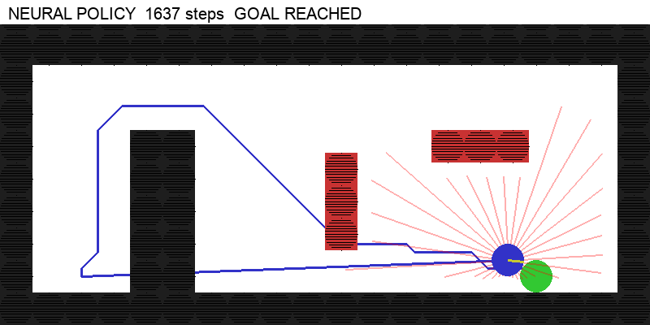

# Предобучение и reinforcement learning для RoboTaxi

## 1. Постановка задачи

Во второй работе я обучал агента управлять автомобилем из первой работы. Агент должен доехать до конечной цели, объезжая статические и движущиеся препятствия. Действия и физика среды взяты с первой домашки.

Сначала я использовал PPO с обучением с нуля и менял награды, промежуточные цели и длительность эпизода. Эти эксперименты улучшили продвижение по карте, но не дали успешного доезда. После этого я реализовал контроллер Pure Pursuit, предобучение по его действиям, DAgger и дообучение PPO.

Итоговая нейросеть достигает цели в исходном сценарии карты 0: 20 из 20 детерминированных и 20 из 20 стохастических эпизодов без столкновений.

## 2. Среда, наблюдения и действия

### Динамика автомобиля

Используется kinematic bicycle model из первого репорта:

Интегрирование выполняется методом Эйлера, $\Delta t=1/60$ секунды. Скорость ограничена снизу нулём, заднего хода нет. В финальной конфигурации $L=1$, коэффициент сопротивления $c=0.7$, ускорение ограничено диапазоном $[-3,3]$, руль — $[-40^\circ,40^\circ]$.

Завершение эпизода происходит при достижении цели, столкновении, выходе за карту или исчерпании лимита шагов. В финальном обучении лимит равен 3000 шагам, то есть 50 секундам симуляции.

### Наблюдение

Базовый вариант (с которого начали) PPO использует 69 признаков при 32 лучевых сенсорах. Финальная версия добавляет три навигационных признака и использует 72 входа:

| Компонента | Размер |
|---|---:|
| Расстояние до ближайшего участка штатного маршрута | 1 |
| Направление этого участка | 2 |
| Векторы 32 лучевых измерений | 64 |
| Текущая скорость | 1 |
| Рекомендованная скорость | 1 |
| Вектор до точки впереди по опорному маршруту в координатах машины | 2 |
| Доля пройденной длины опорного маршрута | 1 |
| **Всего** | **72** |

Вектор до точки впереди делится на радиус обзора, равный 5. Опорный маршрут строится по статической карте на сетке с шагом 0.25 и запасом до центров статических препятствий 1.25. Точка впереди выбирается на расстоянии 1.3 вдоль маршрута от проекции автомобиля.

Рекомендованная скорость зависит от кривизны и прогноза движения препятствий. Прогноз использует истинные положения и скорости движущихся препятствий симулятора, горизонт 2 секунды и 25 отсчётов. При прогнозируемом сближении менее чем на 1.3 скорость задаётся равной нулю. Это дополнительная информация от среды, а не восприятие, выученное только по лучам.

## 3. Функция награды

### Текущая плотная награда

Пусть $D_t$ оставшееся расстояние до цели по статическому полю кратчайших путей, $v_{t+1}$ скорость после действия, $v^*_{t+1}$ рекомендованная скорость в новом наблюдении. На обычном шаге:

$$
\begin{aligned}
r_t^{dense}={}&0.2(D_t-D_{t+1})-0.01\Delta t\\
&-3\Delta t\,I_t
-0.2(v_{t+1}-v^*_{t+1})^2\Delta t
-0.2\Delta t\,S_t.
\end{aligned}
$$

Здесь

$$
I_t=\mathbf 1\{v_{t+1}<0.05\;\land\;v^*_{t+1}>0.05\}.
$$

$S_t$ равен единице после 3 секунд без улучшения лучшего оставшегося маршрутного расстояния хотя бы на 0.1. Успешное улучшение сбрасывает счётчик застоя.

| Компонента | Назначение |
|---|---|
| $0.2(D_t-D_{t+1})$ | Поощряет продвижение с учётом статических препятствий; удаление штрафуется симметрично |
| $-0.01\Delta t$ | Небольшая стоимость времени |
| $-3\Delta t I_t$ | Штраф за остановку, когда скоростной ориентир допускает движение |
| $-0.2(v_{t+1}-v^*_{t+1})^2\Delta t$ | Штраф за отклонение от рекомендованной скорости |
| $-0.2\Delta t S_t$ | Дополнительный штраф за отсутствие нового прогресса |


### Терминальные награды

$$
r_t=
\begin{cases}
-100,&\text{столкновение или выход за карту},\\
+100,&\text{цель достигнута без столкновения},\\
r_t^{dense},&\text{иначе}.
\end{cases}
$$

Терминальная награда заменяет плотную награду этого шага. Отдельного штрафа за тайм-аут в финальной конфигурации нет.

### Промежуточные цели

В отдельных экспериментах я добавлял от двух до пяти точек на начальном статическом маршруте. За каждую начислялся однократный бонус $10/N$, где $N$ количество точек. Точки требовалось посещать по порядку, радиус достижения составлял 0.75. Промежуточная точка не завершала эпизод.

В финальной модели этот механизм отсутствует (выключен): `subgoal_fractions=[]`, бонусы за промежуточные точки не начисляются.

## 4. Обучение PPO

Я реализовал PPO с отдельными сетями актора и критика в JAX/Flax NNX. PPO оптимизирует ограниченную отношением вероятностей целевую функцию на данных взаимодействия со средой.

### Архитектура

Актор: `72 to 256 to 128 to 4`. Четыре выхода задают два средних и два логарифма стандартных отклонений нормального распределения. Логарифмы стандартных отклонений ограничиваются диапазоном $[-5,2]$.

Критик: `72 to 256 to 128 to 1`. Он предсказывает дисконтированную ценность состояния и обучается по MSE.

### Целевая функция

Для PPO используется clipped surrogate objective:

$$
L_{clip}=-\mathbb E_t\left[
\min\left(\rho_t A_t,
\operatorname{clip}(\rho_t,1-\epsilon,1+\epsilon)A_t\right)
\right],
$$

В финальном варианте:

$$
L_{actor}=L_{clip}-0.01H(\pi)
+0.5\,\operatorname{mean}\left[(\tanh\mu_\theta(o)-u_{teacher}(o))^2\right].
$$

Последнее слагаемое удерживает освоенное управление рядом с учителем. Это штраф в функции потерь, он не прибавляется к награде среды и не входит в эпизодический return.

## 5. Предобучение: Pure Pursuit, BC и DAgger

### Контроллер-учитель

Для точки впереди в координатах машины $(x_{local},y_{local})$ я рассчитываю кривизну и угол руля:

$$
\kappa=\frac{2y_{local}}{\max(x_{local}^2+y_{local}^2,0.05)},\qquad
\delta=\arctan(L\kappa).
$$

Базовая рекомендованная скорость:

$$
v^*=\frac{0.8}{1+0.5|\kappa|}.
$$

Прогноз препятствий может заменить её нулём. Ускорение учителя:

$$
a=3(v^*-v)+cv.
$$

Слагаемое $cv$ компенсирует сопротивление. Ускорение и руль нормализуются и ограничиваются допустимыми диапазонами.

### Behavioral cloning

Для сбора демонстраций я менял положение старта на величину до 0.12 по каждой оси, направление до 0.12 радиан, начальную скорость от 0 до 0.15 и фазу движения препятствий от 0 до 10 секунд. Для координаты $y$ дополнительно используется нижняя граница 1.0.

Из 32 попыток учителя успешными оказались 9. Только они вошли в исходный датасет: 15 630 пар наблюдение — действие. Seed сбора данных — 1234.

Актор обучался 5000 обновлений, batch 512, Adam с LR $3\cdot10^{-4}$.

После BC самостоятельный проезд не получился: 0 из 5, все эпизоды завершились столкновением

### DAgger

Я добавил сбор меток учителя в состояниях, посещённых текущей политикой. Такой принцип используется в DAgger: [Ross, Gordon, Bagnell, 2011](https://proceedings.mlr.press/v15/ross11a.html).

Выполнены три раунда по 12 эпизодов с вариациями старта. Исполняемое действие задаётся смесью:

$$
u=\beta u_{teacher}+(1-\beta)u_{network},\qquad
\beta\in\{0.5,0.2,0.0\}.
$$

На каждом посещённом наблюдении сохраняется правильное действие учителя. Новые данные добавляются к предыдущим, включая данные неуспешных проездов. После каждого раунда выполняется 2500 обновлений актора с LR $10^{-4}$ и batch 512. Уже после первого раунда сеть самостоятельно достигала цели в исходном сценарии.

Перед PPO критик предобучался 2000 обновлений на дисконтированных возвратах собранных траекторий. Для инициализации исследования выход стандартного отклонения актора выставлялся в 0.03; при последующем PPO он может обучаться.

## 6. Эксперименты с обучением с нуля

Все ранние серии использовали карту 0, фиксированный старт и seed обучения 67.

### Изменения награды

Базовый PPO и шесть вариантов сравнивались при бюджете 3 млн шагов на вариант. Ни один не достиг конечной цели.


### Количество и расположение промежуточных точек

После этого я сохранил маршрутную награду и штраф за застой и проверил 10 размещений двух–пяти промежуточных целей, каждое с обучением с нуля на 3 млн шагов. Дополнительный контроль не имел промежуточных целей. Полный бюджет бонусов всегда равнялся 10.

В варианте с пятью равномерными точками увеличение лимита оценки до 1500 дало прогресс 14.85, но конечная цель не достигалась. Машина проходила мимо третьей точки, поэтому последовательность бонусов блокировалась, хотя пространственное продвижение продолжалось. Большее число достигнутых точек также не всегда означало больший прогресс: результат зависел от их размещения.

### Длительность эпизода и продолжение обучения

Обучение с нуля по 3 млн шагов с лимитами 2000 и 3000 оказалось хуже исходного варианта с лимитом 1000. При общем лимите оценки 3000 прогресс итоговых политик составил 5.35 и 4.65 против 14.85 у прежнего лидера. Удлинение эпизода уменьшило число сбросов при том же бюджете шагов и изменило распределение посещаемых состояний.

Сырые return разных наград нельзя напрямую сравнивать как качество управления. Поэтому основные критерии этих серий конечный успех, столкновения и пространственное продвижение.

## 7. Результат предобучения и PPO

### Исходный сценарий

| Этап | Успешные эпизоды | Средняя длина, шаги | Средний return | Столкновения |
|---|---:|---:|---:|---:|
| BC | 0/5 | 1662 | −96.7565 | 5/5 |
| DAgger 1 | 5/5 | 1699 | 103.3584 | 0/5 |
| DAgger 2 | 5/5 | 1684 | 103.4140 | 0/5 |
| DAgger 3 | 5/5 | 1688 | 103.3619 | 0/5 |
| PPO, детерминированно | **20/20** | **1637** | **103.3205** | **0/20** |
| PPO, стохастически | **20/20** | **1638** | **103.3176** | **0/20** |.

Выбраны финальные веса PPO на 200 000 дополнительных шагах. При выборе среди сохранённых кандидатов приоритет отдавался доле успехов, затем меньшему числу столкновений, меньшей длине эпизода и return. Повторная стохастическая оценка с лимитом 2000 и seed 777 также дала 20/20, средняя длина 1637.2 шага.


## 8. Локальный запуск и демонстрация

Команды выполняются из корня репозитория с подготовленным `.venv`.

Просмотр одного проезда финальной политики, без обучения:

```bash
JAX_PLATFORM_NAME=cpu PYTHONPATH=src .venv/bin/python -m algorithms.ppo evaluate \
  --checkpoint report_assets/best_policy.msgpack \
  --episodes 1 --render
```



[Анимация проезда](report_assets/assignment_2_drive.gif).
